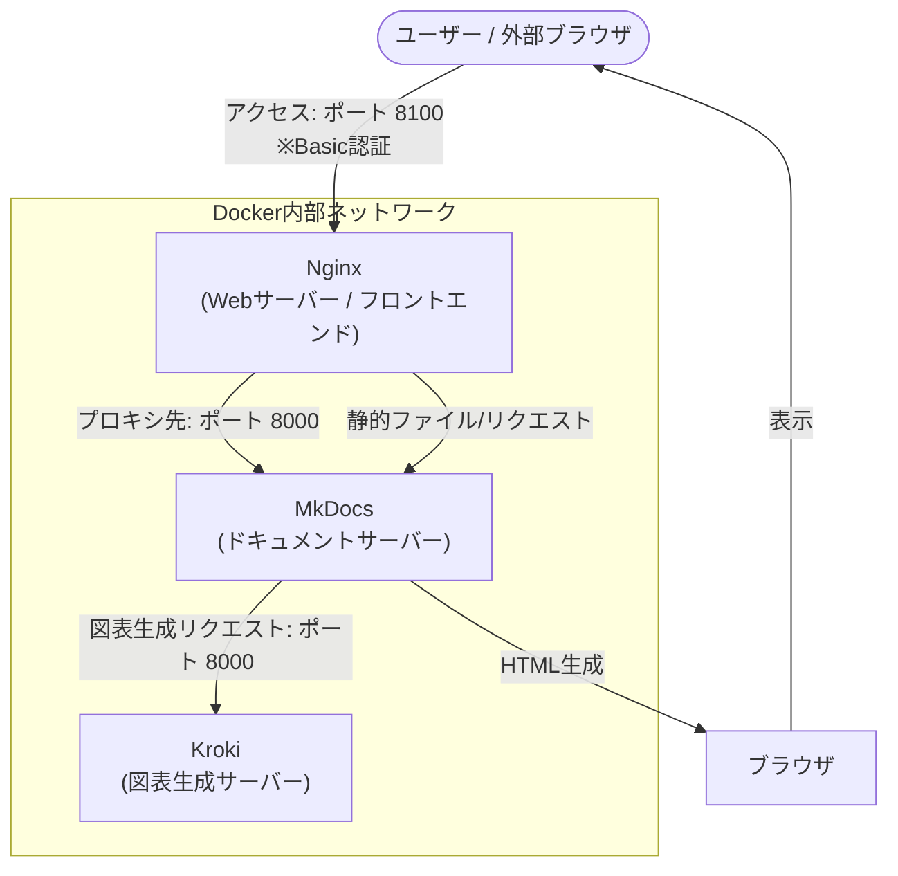

# 📖 プロジェクト名: コンテナ化された技術ドキュメントプラットフォーム

## 💡 概要 (Project Overview)
本リポジトリは、Markdownベースのドキュメントソースを起点として、プロフェッショナルな静的サイトを構築・公開するための完全な環境を提供します。ドキュメンテーションのビルドプロセスには MkDocs を使用し、Docker Compose によりサービスを分離・統合することで、開発用と本番環境の分離、およびセキュリティ管理（Nginx による認証・ルーティング）を実現しています。

このシステムは以下の核となる機能を備えています:
* **静的サイト生成**: `mkdocs` を使用し、Markdown を美しいウェブサイトに変換します。
* **ウェブサービングとルーティング**: `nginx` をリバースプロキシとして機能させ、単一エンドポイントから全サービスへのアクセスを管理し、必要に応じて認証を提供します。
* **図表生成**: PlantUML に対応した `kroki` サービスを組み込み、可視化された図をドキュメントに埋め込みます。

## 🚀 Quick Reference
```bash
sudo apt update
sudo apt install apache2-utils

htpasswd -c htpasswd {ユーザー名}

docker compose build

docker compose up -d

docker compose up --build serve
```

## 🏗️ システム構成 (Architecture & Components)
本システムは `docker-compose.yml` により、以下の 3 つの独立したサービスで構成されています。

### 🔄 アーキテクチャ図 (Architecture Diagram)



### コンポーネント詳細
* **Nginx**: 全トラフィックを受け取り、認証とルーティングを担当するエッジ層です。
* **MkDocs**: ドキュメントソースから静的 HTML を生成します。
* **Kroki**: PlantUML を外部 API として受け取り、描画後の SVG 画像を返します。

✅ **成功確認**: ビルドが成功すると、`site/` ディレクトリに HTML ファイル群が生成されます。

🌐 **アクセス**: ブラウザから `http://localhost:8100` にアクセスしてください。（Nginx の認証設定により、本番環境と同様の形でドキュメントを閲覧できます）

## 🛠️ 設定カスタマイズガイド
* **`mkdocs.yml`**: テーマ、目次構造（ナビゲーション）、プラグインの動作を調整します。
* **`nginx.conf`**: ドメイン変更、リバースプロキシの挙動変更、または認証の有効/無効化を行います。
* **ドキュメント**: 新しい記事は必ず `docs/` ディレクトリ内に作成してください。
