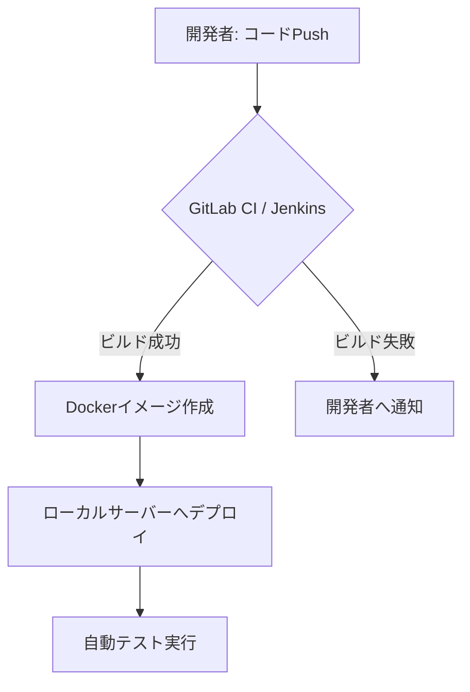
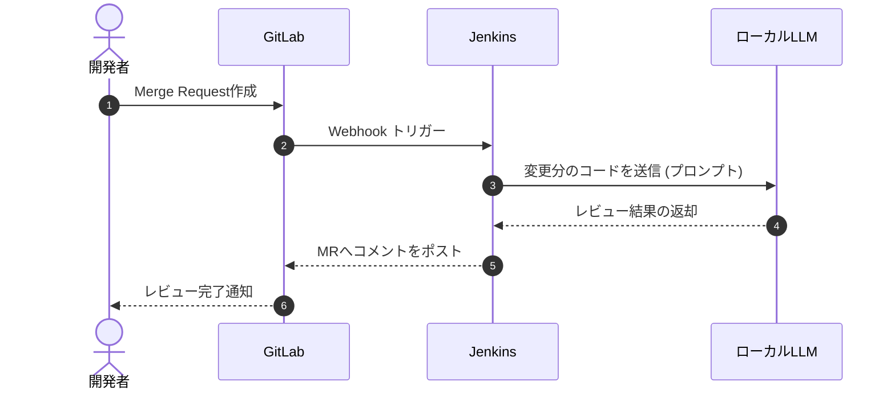
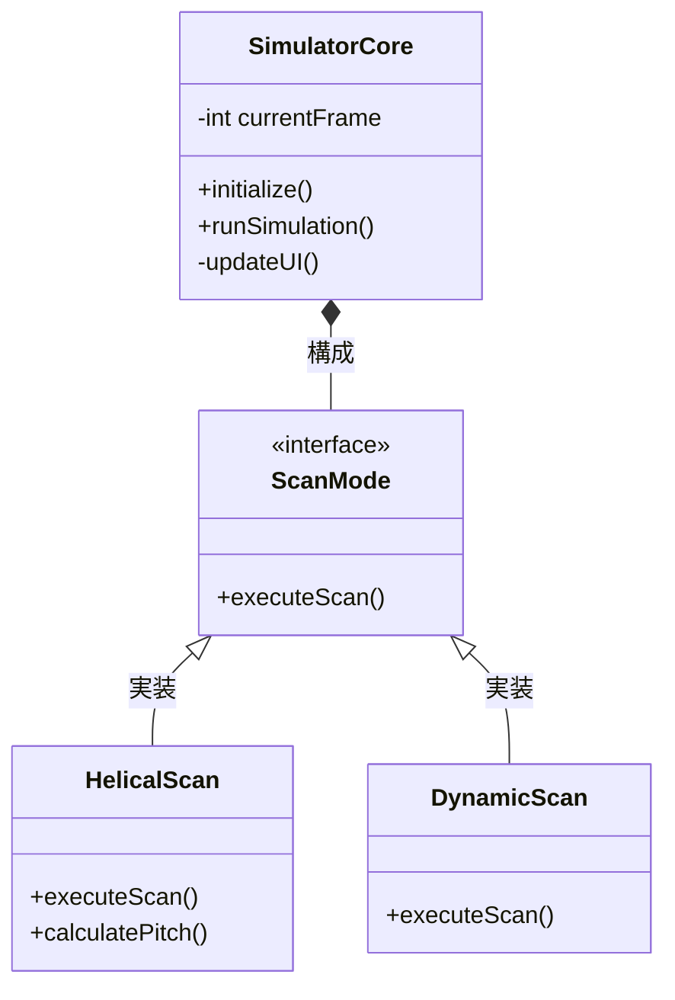
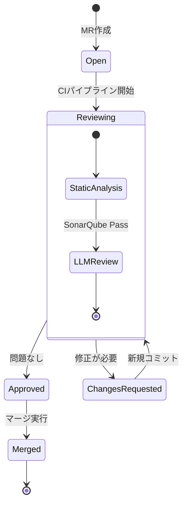
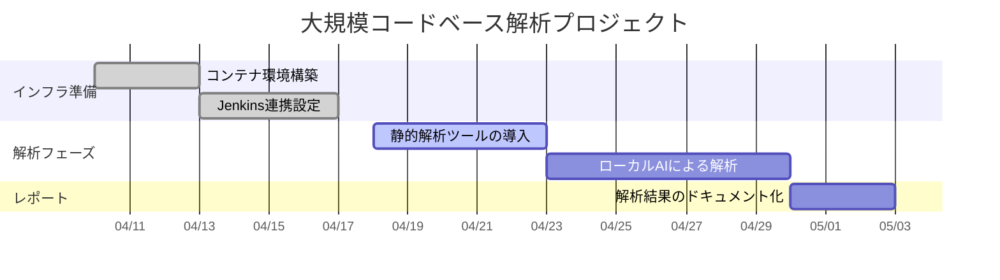
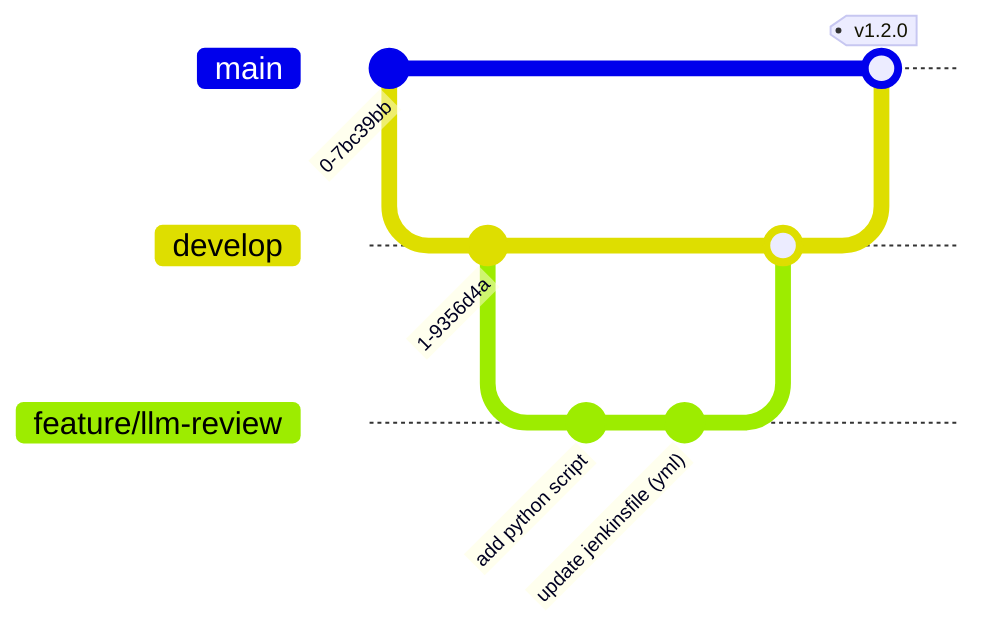
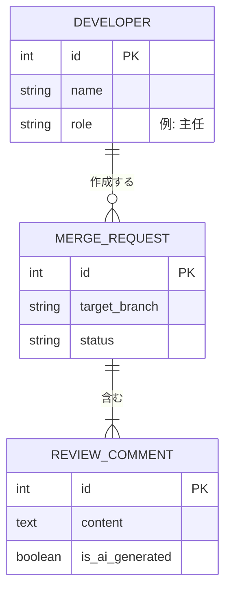
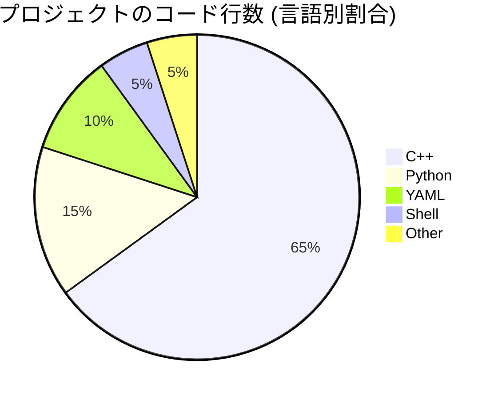

Markdownファイルとしてそのままコピー＆ペーストして使用できる、Mermaidの主要なグラフを網羅したサンプル集です。

プレビュー機能のあるエディタ（VS CodeやGitLabなど）に貼り付けることで、各種図表が即座にレンダリングされます。

---

## 1. フローチャート (Flowchart)
システム全体の処理の流れや、パイプラインの構造を表現するのによく使われます。

## 2. シーケンス図 (Sequence Diagram)
複数システム間のAPI呼び出しや、非同期処理のやり取りを時系列で表現します。

## 3. クラス図 (Class Diagram)
オブジェクト指向設計におけるクラスの構造や、インターフェースの依存関係を整理します。

## 4. 状態遷移図 (State Diagram)
プロセスやタスクが、どのような条件でどの状態に変化するかを定義します。

## 5. ガントチャート (Gantt Chart)
プロジェクトのスケジュールや、タスクの依存関係を可視化します。

## 6. Gitグラフ (Git Graph)
ブランチの分岐、コミット履歴、マージの運用フロー（Git Flowなど）を図示します。

## 7. ER図 (Entity Relationship Diagram)
データベースのテーブル構造や、エンティティ間のリレーション（1対多など）を表現します。

## 8. 円グラフ (Pie Chart)
リソースの割合や、データの構成比をシンプルに示します。

---
