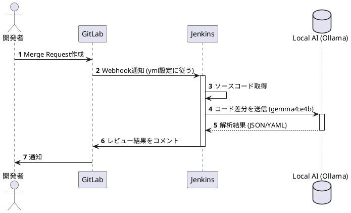
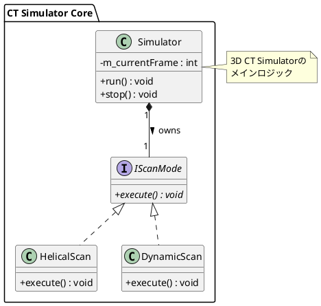
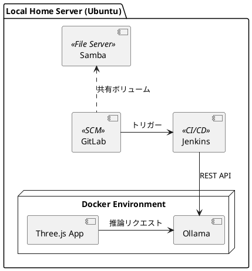
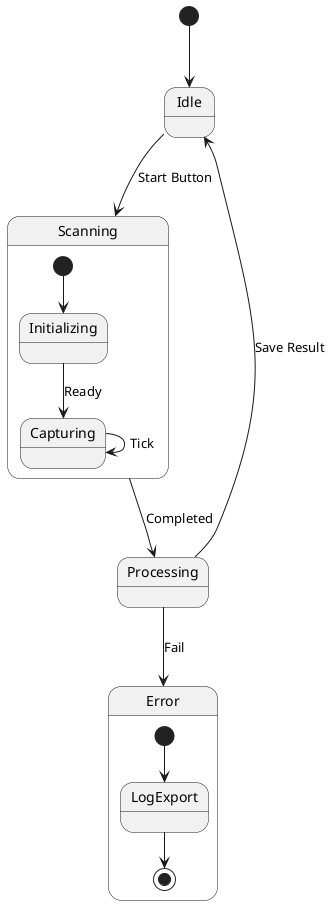
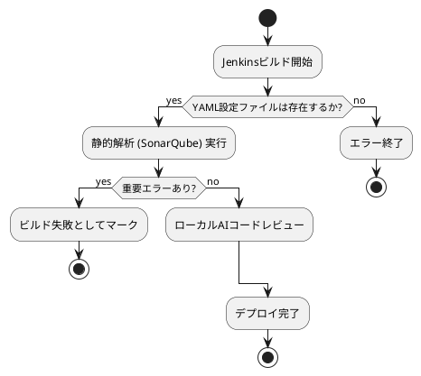
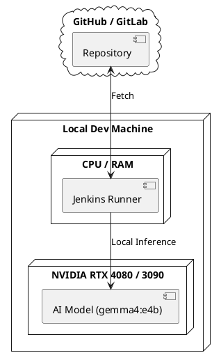

PlantUMLのサンプル集です。Mermaidに比べて記法がより柔軟で、特に大規模なシステム構成や複雑なC++のクラス構造を記述するのに向いています。

Markdownファイル内でPlantUMLを表示するには、VS Codeの「PlantUML」拡張機能や、GitLab/GitHubのプラグイン（環境によります）が必要です。

---

## 1. シーケンス図 (Sequence Diagram)
Mermaidよりも「戻り値」や「並列処理」の表現が強力です。ここでは、開発者が構築中の「ローカルAIによるコードレビュー」のフローを例にします。

## 2. クラス図 (Class Diagram)
C++の1,200万行を超える大規模プロジェクトの解析結果を整理するのに適した、詳細な定義が可能です。

## 3. コンポーネント図 (Component Diagram)
Ubuntuサーバー上で稼働するDockerコンテナ群の依存関係を可視化します。

## 4. 状態遷移図 (State Diagram)
スキャンモードの切り替えや、解析パイプラインのライフサイクルを定義します。

## 5. アクティビティ図 (Activity Diagram)
複雑な条件分岐を伴うアルゴリズムや、CI/CDパイプラインのロジックをフローチャート形式で記述します。

## 6. デプロイメント図 (Deployment Diagram)
物理的なハードウェア（RTX 4080/3090など）とソフトウェアの配置関係を示します。

---

> **Tips:** PlantUMLはMermaidよりも「配置」の制御が柔軟です。`TD`（上から下）だけでなく、`-right->` や `-down->` を使って矢印の方向を細かく指定することで、複雑な図もきれいに整理できます。
